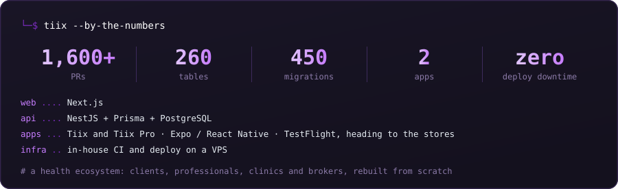
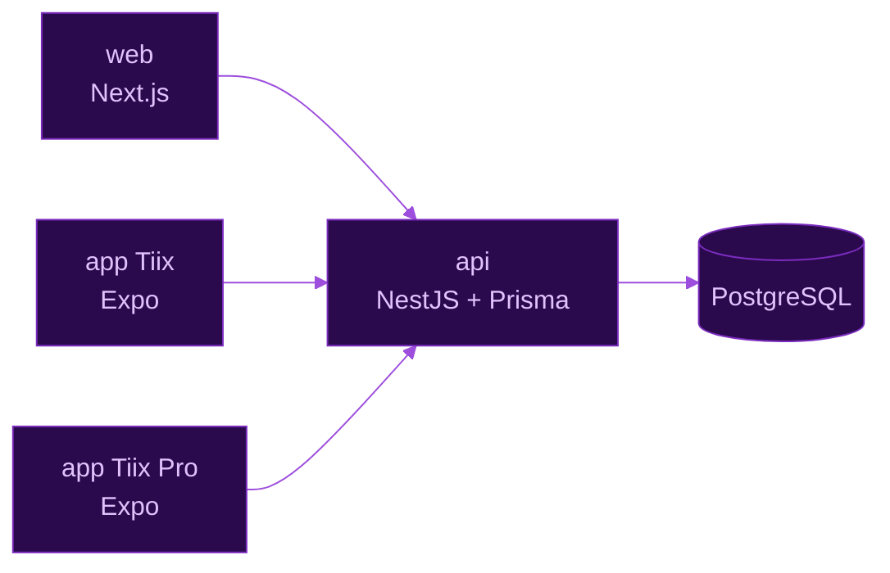
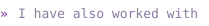
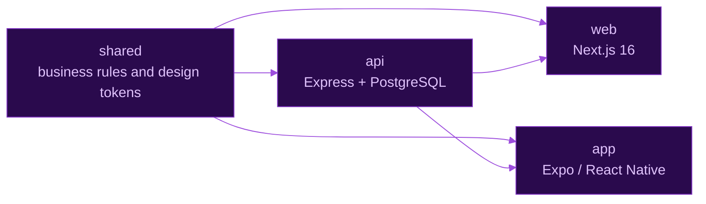
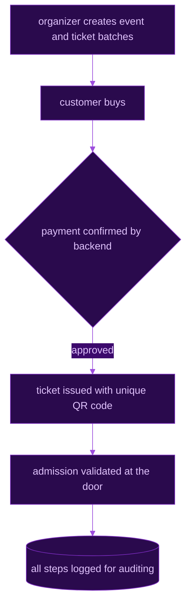
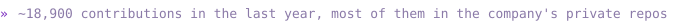

<p align="right">
  <a href="https://github.com/ChaconLucas/ChaconLucas/blob/main/README.en.md"></a>&nbsp;
  <a href="https://github.com/ChaconLucas"></a>
</p>

<p align="center">
  
</p>

<p align="center">
  <a href="https://portfolio-delta-five-78.vercel.app"></a>
  <a href="https://linkedin.com/in/lucas-chacon-129414a7"></a>
  <a href="https://github.com/ChaconLucas?tab=repositories"></a>
</p>


<p align="center">
  
</p>

<br>


<p align="center">
  
</p>

<p align="center">
  <a href="https://tiix.com.br"></a>
  <a href="https://tiixpro.com.br"></a>
</p>

<details>
<summary><code>&gt;_ view the architecture</code></summary>



</details>

<br>


<p align="center">
  
</p>

<p align="center">
  
  
  
  
  
  
  
  
  
  
  
</p>

<p align="center">
  
</p>

<p align="center">
  
</p>

<p align="center">
  
</p>

<p align="center">
  
</p>

<details>
<summary><code>>_ view the complete stack by layer</code></summary>

<br>


</details>

<br>


<table>
  <tr>
    <td width="50%" valign="top">

### TIIX
**Tech lead — Tiix 2.0** &nbsp;·&nbsp; `2026 — present`

     

I lead the technical side of **Tiix 2.0**, the company's health ecosystem
rebuilt from scratch: a monorepo with web, API and **two apps**, in-house CI
and deploy on a VPS, with **zero downtime**.

Before that, on the legacy system: SQL queries and stored procedures,
REST/JSON APIs, OAuth 2.0 integrations, webhooks and cron jobs, with PHP,
jQuery and MySQL.

</td>
<td width="50%" valign="top">

### D&Z
**Full Stack Developer** &nbsp;·&nbsp; `Nov 2025 — Apr 2026`

  

PHP admin dashboards for an internal management system, with interfaces
for creating, listing and maintaining records.

</td>
  </tr>
</table>

<br>


<table>
  <tr>
    <td colspan="2" valign="top">

### 🎮 coworking-agents
 `Node.js` `Pixel art` `Open source`

A pixel-art virtual office for **Claude Code and Codex**: each session becomes a
character in real time. See who needs you and **reply to agents directly from
the office**, without constantly switching back to the terminal.

Walk around with **WASD**, customize your office and explore the trophy room
with **74 achievements** and the decoration shop. Rooms grouped by repository,
file conflict alerts, usage, token and estimated cost reports — and a cat that
visits agents waiting for you.

<a href="https://github.com/ChaconLucas/coworking-agents"></a>

<details>
<summary><b>▶ Watch the office in action</b></summary>

<br>


Office → agent panel → conversation → usage report → server room → rooftop.

<a href="https://portfolio-delta-five-78.vercel.app/demos/coworking/index.html?lang=en"><b>▶ Try the interactive demo</b></a>

</details>


**Try it:** `npx coworking-agents`

<a href="https://github.com/ChaconLucas/coworking-agents"></a>

</td>
  </tr>
  <tr>
    <td width="50%" valign="top">

### 📟 TokenBar
  

AI usage from **7 platforms** in the Mac menu bar — and also on an LED
display, iPhone, Android and Apple Watch.

**Install:** `brew install --cask chaconlucas/tokenbar/tokenbar`

<a href="https://github.com/ChaconLucas/tokenbar"></a>

</td>
<td width="50%" valign="top">

### ⌚ WatchOps
  

Control the Mac **from the iPhone and the Apple Watch**, with an AI
assistant that runs on the Mac itself.


</td>
  </tr>
  <tr>
    <td width="50%" valign="top">

### 💡 Luz de Casa
 

Controls **CozyLife bulbs over the local network**, no cloud, right from
the Mac menu bar.


</td>
<td width="50%" valign="top">

### 🏋️ BasalFit
   

A health app for people who work out, designed in **Liquid Glass**.


</td>
  </tr>
</table>

<br>


<table>
  <tr>
    <td width="50%" valign="top">

### ⚡ FLASH
    

A marketplace for tattoo and body piercing supplies with fast motorcycle delivery.
A monorepo with four packages — `shared` (business rules and design tokens), `api`
(Express + PostgreSQL), `web` (Next.js 16) and `app` (Expo / React Native) — with
**full feature parity between mobile and web**. Uber Direct delivery integration
and continuous deployment on Render.

<details>
<summary><code>&gt;_ view the monorepo</code></summary>



</details>

<a href="https://flash-web-srgm.onrender.com"></a>


</td>
<td width="50%" valign="top">

### 🎟️ GateCheck
   

Ticket sales and admission management for nightclubs and events.
Complete workflow: organizer creates an event and ticket batches → customer buys →
backend confirms payment → ticket issued with a **unique QR code** → admission
validated at the door → every step logged for auditing.

<details>
<summary><code>&gt;_ view the workflow</code></summary>



</details>


</td>
  </tr>
  <tr>
    <td width="50%" valign="top">

### 🏄 WSL SporTV Games
  

An interactive games MVP for WSL SporTV: *Drop Sua Onda* (a quiz that generates a
surfer profile) and *Jurado por Um Dia* (players give a score and compare it with the
official judge's). Configurable registration before or after playing, with prizes
at the end.

<a href="https://wsl-sportv-games.vercel.app"></a>


</td>
<td width="50%" valign="top">

### 🛍️ Rare7 — Complete e-commerce
  

An e-commerce platform where I lead technical development: storefront, admin dashboard,
integrated CMS, **MercadoPago** checkout, automated emails, Chart.js dashboards,
AI chat (Groq) and audit logs.

<a href="https://github.com/ChaconLucas/rare7"></a>

</td>
  </tr>
  <tr>
    <td width="50%" valign="top">

### 🏭 Factory Production Management
  

A full-stack factory production management system: intelligent production order
planning, inventory control and efficiency insights from manufacturing data.

<a href="https://github.com/ChaconLucas/projdata_project"></a>

</td>
<td width="50%" valign="top">

### 🤖 FURIA Bot
  

A Telegram bot for FURIA's Counter-Strike fans: upcoming matches, current roster,
latest results and fan chants — with scraping to keep the data up to date.

<a href="https://github.com/ChaconLucas/furia-telegram-bot"></a>

</td>
  </tr>
  <tr>
    <td width="50%" valign="top">

### 🎤 Tiixokê
   

Web karaoke: finds songs on YouTube, plays the video with lyrics and **scores you
from 0 to 100** by analyzing microphone volume and pitch variation in real time,
with a suspense animation before revealing the score.


</td>
<td width="50%" valign="top">

### 📱 Customer and Product Management
   

A mobile app with a local database, Redux Toolkit, React Hook Form + Yup and
Expo Router — customer and product CRUD with relationships between them.

<a href="https://github.com/ChaconLucas/react_native_target"></a>

</td>
  </tr>
  <tr>
    <td width="50%" valign="top">

### 🧠 AIpply
`JavaScript` `Python`

AI-assisted job application automation — reading job descriptions, tailoring the
profile and generating application materials.


</td>
<td width="50%" valign="top">

### 🧮 Target Challenge
 

Commissions, inventory and interest in C# / .NET 8, with web UI, API and tests.

<a href="https://github.com/ChaconLucas/DesafioTarget"></a>

</td>
  </tr>
</table>

<br>


<p align="center">
  
</p>

<p align="center">
  <picture>
    <source media="(prefers-color-scheme: dark)" srcset="https://streak-stats.demolab.com/?user=ChaconLucas&amp;locale=en&amp;background=191526&amp;border=3D2B5C&amp;stroke=3D2B5C&amp;ring=9D4EDD&amp;fire=C77DFF&amp;currStreakLabel=C77DFF&amp;sideLabels=E6EDF3&amp;currStreakNum=FFFFFF&amp;sideNums=FFFFFF&amp;dates=8B7AA8&amp;border_radius=14" />
    <source media="(prefers-color-scheme: light)" srcset="https://streak-stats.demolab.com/?user=ChaconLucas&amp;locale=en&amp;background=FBF7FF&amp;border=E0C3FC&amp;stroke=E0C3FC&amp;ring=7B2CBF&amp;fire=9D4EDD&amp;currStreakLabel=7B2CBF&amp;sideLabels=2A0A4D&amp;currStreakNum=1A0033&amp;sideNums=1A0033&amp;dates=6B3FA0&amp;border_radius=14" />
    
  </picture>
</p>

<p align="center">
  <picture>
    <source media="(prefers-color-scheme: dark)" srcset="https://raw.githubusercontent.com/ChaconLucas/ChaconLucas/output/github-contribution-grid-snake-dark.svg" />
    <source media="(prefers-color-scheme: light)" srcset="https://raw.githubusercontent.com/ChaconLucas/ChaconLucas/output/github-contribution-grid-snake.svg" />
    
  </picture>
</p>

<br>


```bash
$ ./contact.sh
[+] portfolio .. portfolio-delta-five-78.vercel.app
[+] linkedin ... linkedin.com/in/lucas-chacon-129414a7
[+] location ... Rio de Janeiro — BR (remote or hybrid)
```

<p align="center">
  
</p>

<p align="center">
  
</p>
