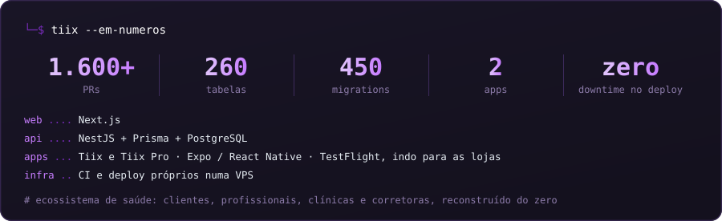
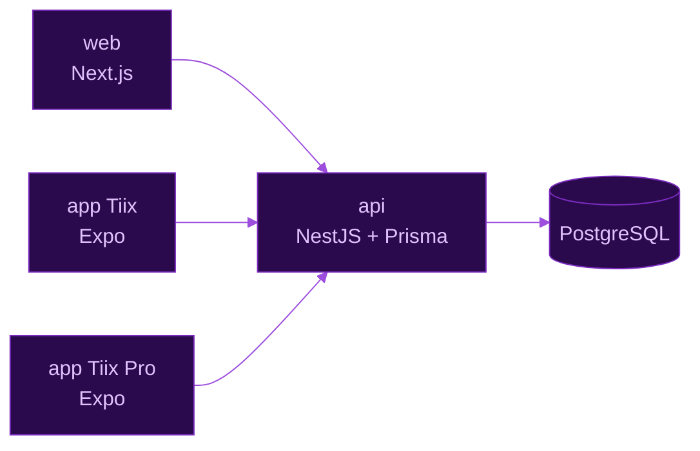
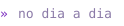
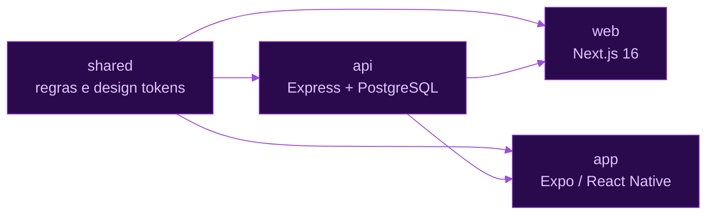
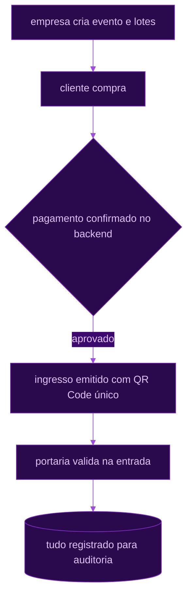

<p align="right">
  <a href="https://github.com/ChaconLucas/ChaconLucas/blob/main/README.en.md"></a>&nbsp;
  <a href="https://github.com/ChaconLucas"></a>
</p>

<p align="center">
  
</p>

<p align="center">
  <a href="https://portfolio-delta-five-78.vercel.app"></a>
  <a href="https://linkedin.com/in/lucas-chacon-129414a7"></a>
  <a href="https://github.com/ChaconLucas?tab=repositories"></a>
</p>


<p align="center">
  
</p>

<br>


<p align="center">
  
</p>

<p align="center">
  <a href="https://tiix.com.br"></a>
  <a href="https://tiixpro.com.br"></a>
</p>

<details>
<summary><code>&gt;_ ver a arquitetura</code></summary>



</details>

<br>


<p align="center">
  
</p>

<p align="center">
  
  
  
  
  
  
  
  
  
  
  
</p>

<p align="center">
  
</p>

<p align="center">
  
</p>

<p align="center">
  
</p>

<p align="center">
  
</p>

<details>
<summary><code>>_ ver a lista completa por camada</code></summary>

<br>


</details>

<br>


<table>
  <tr>
    <td width="50%" valign="top">

### TIIX
**Líder técnico — Tiix 2.0** &nbsp;·&nbsp; `2026 — atual`

     

Lidero a parte técnica da **Tiix 2.0**, o ecossistema de saúde da empresa
reconstruído do zero: monorepo com web, API e **dois apps**, CI e deploy
próprios numa VPS, com **zero downtime**.

Antes, no sistema legado: consultas e procedures em SQL, APIs REST/JSON,
integrações OAuth 2.0, webhooks e rotinas em cron, com PHP, jQuery e MySQL.

</td>
<td width="50%" valign="top">

### D&Z
**Desenvolvedor Full Stack** &nbsp;·&nbsp; `nov/2025 — abr/2026`

  

Painéis administrativos em PHP — sistema interno de gestão, com as telas
de cadastro, listagem e manutenção dos dados.

</td>
  </tr>
</table>

<br>


<table>
  <tr>
    <td colspan="2" valign="top">

### 🎮 coworking-agents
 `Node.js` `Pixel art` `Open source`

Escritório virtual em pixel art para **Claude Code e Codex**: cada sessão vira um
personagem em tempo real. Veja quem precisa de você e **responda aos agentes direto
pelo escritório**, sem voltar ao terminal toda hora.

Ande pelo ambiente com **WASD**, personalize o escritório e explore a sala de troféus
com **74 conquistas** e a loja de decoração. Salas por repositório, alertas de arquivos
em conflito, relatórios de uso, tokens e custo estimado — e um gatinho que visita
quem está esperando você.

<a href="https://github.com/ChaconLucas/coworking-agents"></a>

<details>
<summary><b>▶ Ver o escritório em ação</b></summary>

<br>


Escritório → painel do agente → conversa → relatório de uso → sala de servidores → terraço.

<a href="https://portfolio-delta-five-78.vercel.app/demos/coworking/index.html?lang=pt"><b>▶ Experimentar a demonstração interativa</b></a>

</details>


**Para testar:** `npx coworking-agents`

<a href="https://github.com/ChaconLucas/coworking-agents"></a>

</td>
  </tr>
  <tr>
    <td width="50%" valign="top">

### 📟 TokenBar
  

O uso de IA de **7 plataformas** na barra de menus do Mac — e também num
display de LED, no iPhone, no Android e no Apple Watch.

**Para instalar:** `brew install --cask chaconlucas/tokenbar/tokenbar`

<a href="https://github.com/ChaconLucas/tokenbar"></a>

</td>
<td width="50%" valign="top">

### ⌚ WatchOps
  

Controle do Mac **pelo iPhone e pelo Apple Watch**, com um assistente de
IA que roda no próprio Mac.


</td>
  </tr>
  <tr>
    <td width="50%" valign="top">

### 💡 Luz de Casa
 

Controla as lâmpadas **CozyLife pela rede local**, sem nuvem, direto da
barra de menus do Mac.


</td>
<td width="50%" valign="top">

### 🏋️ BasalFit
   

App de saúde para quem treina, com o visual em **Liquid Glass**.


</td>
  </tr>
</table>

<br>


<table>
  <tr>
    <td width="50%" valign="top">

### ⚡ FLASH
    

Marketplace de materiais para tatuagem e body piercing com entrega rápida por motoboy.
Monorepo com quatro pacotes — `shared` (regras e design tokens), `api` (Express +
PostgreSQL), `web` (Next.js 16) e `app` (Expo / React Native) — mantendo **paridade
total entre app e web**. Integração de frete com Uber Direct e deploy contínuo na Render.

<details>
<summary><code>&gt;_ ver o monorepo</code></summary>



</details>

<a href="https://flash-web-srgm.onrender.com"></a>


</td>
<td width="50%" valign="top">

### 🎟️ GateCheck
   

Plataforma de venda de ingressos e controle de entrada para boates e eventos.
Fluxo completo: empresa cria evento e lotes → cliente compra → pagamento confirmado
no backend → ingresso emitido com **QR Code único** → portaria valida na entrada →
tudo registrado para auditoria.

<details>
<summary><code>&gt;_ ver o fluxo</code></summary>



</details>


</td>
  </tr>
  <tr>
    <td width="50%" valign="top">

### 🏄 WSL SporTV Games
  

MVP de jogos interativos para o WSL SporTV: *Drop Sua Onda* (quiz que gera um perfil
de surfista) e *Jurado por Um Dia* (o usuário dá a nota e compara com a do juiz oficial).
Cadastro configurável antes ou depois da partida, com premiação no final.

<a href="https://wsl-sportv-games.vercel.app"></a>


</td>
<td width="50%" valign="top">

### 🛍️ Rare7 — E-commerce completo
  

Plataforma de e-commerce que lidero tecnicamente: loja virtual, painel administrativo,
CMS integrado, checkout **MercadoPago**, automação de e-mails, dashboards com Chart.js,
chat com IA (Groq) e logs de auditoria.

<a href="https://github.com/ChaconLucas/rare7"></a>

</td>
  </tr>
  <tr>
    <td width="50%" valign="top">

### 🏭 Factory Production Management
  

Sistema full stack de gestão de produção fabril: planejamento inteligente de ordens,
controle de estoque e insights de eficiência a partir dos dados de manufatura.

<a href="https://github.com/ChaconLucas/projdata_project"></a>

</td>
<td width="50%" valign="top">

### 🤖 Bot da FURIA
  

Bot de Telegram para a torcida da FURIA (CS): próximos jogos, lineup atual, últimos
resultados e frases da torcida — com scraping para manter os dados atualizados.

<a href="https://github.com/ChaconLucas/furia-telegram-bot"></a>

</td>
  </tr>
  <tr>
    <td width="50%" valign="top">

### 🎤 Tiixokê
   

Karaokê web: busca a música no YouTube, toca o vídeo com a letra e **pontua você de
0 a 100** analisando volume e variedade de pitch captados pelo microfone em tempo real,
com animação de suspense na revelação da nota.


</td>
<td width="50%" valign="top">

### 📱 Gestão de Clientes e Produtos
   

App mobile com banco local, Redux Toolkit, React Hook Form + Yup e Expo Router —
CRUD de clientes e produtos com vínculos entre eles.

<a href="https://github.com/ChaconLucas/react_native_target"></a>

</td>
  </tr>
  <tr>
    <td width="50%" valign="top">

### 🧠 AIpply
`JavaScript` `Python`

Automação de candidaturas com apoio de IA — leitura de vaga, adequação do perfil e
geração do material de aplicação.


</td>
<td width="50%" valign="top">

### 🧮 Desafio Target
 

Comissões, estoque e juros em C# / .NET 8, com interface web, API e testes.

<a href="https://github.com/ChaconLucas/DesafioTarget"></a>

</td>
  </tr>
</table>

<br>


<p align="center">
  
</p>

<p align="center">
  <picture>
    <source media="(prefers-color-scheme: dark)" srcset="https://streak-stats.demolab.com/?user=ChaconLucas&amp;locale=pt_BR&amp;background=191526&amp;border=3D2B5C&amp;stroke=3D2B5C&amp;ring=9D4EDD&amp;fire=C77DFF&amp;currStreakLabel=C77DFF&amp;sideLabels=E6EDF3&amp;currStreakNum=FFFFFF&amp;sideNums=FFFFFF&amp;dates=8B7AA8&amp;border_radius=14" />
    <source media="(prefers-color-scheme: light)" srcset="https://streak-stats.demolab.com/?user=ChaconLucas&amp;locale=pt_BR&amp;background=FBF7FF&amp;border=E0C3FC&amp;stroke=E0C3FC&amp;ring=7B2CBF&amp;fire=9D4EDD&amp;currStreakLabel=7B2CBF&amp;sideLabels=2A0A4D&amp;currStreakNum=1A0033&amp;sideNums=1A0033&amp;dates=6B3FA0&amp;border_radius=14" />
    
  </picture>
</p>

<p align="center">
  <picture>
    <source media="(prefers-color-scheme: dark)" srcset="https://raw.githubusercontent.com/ChaconLucas/ChaconLucas/output/github-contribution-grid-snake-dark.svg" />
    <source media="(prefers-color-scheme: light)" srcset="https://raw.githubusercontent.com/ChaconLucas/ChaconLucas/output/github-contribution-grid-snake.svg" />
    
  </picture>
</p>

<br>


```bash
$ ./contato.sh
[+] portfolio .. portfolio-delta-five-78.vercel.app
[+] linkedin ... linkedin.com/in/lucas-chacon-129414a7
[+] local ...... Rio de Janeiro — BR (remoto ou híbrido)
```

<p align="center">
  
</p>

<p align="center">
  
</p>
